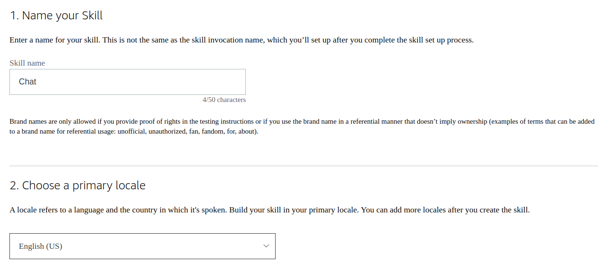
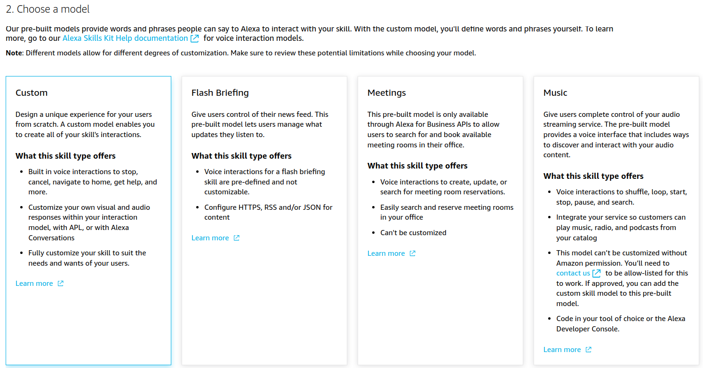
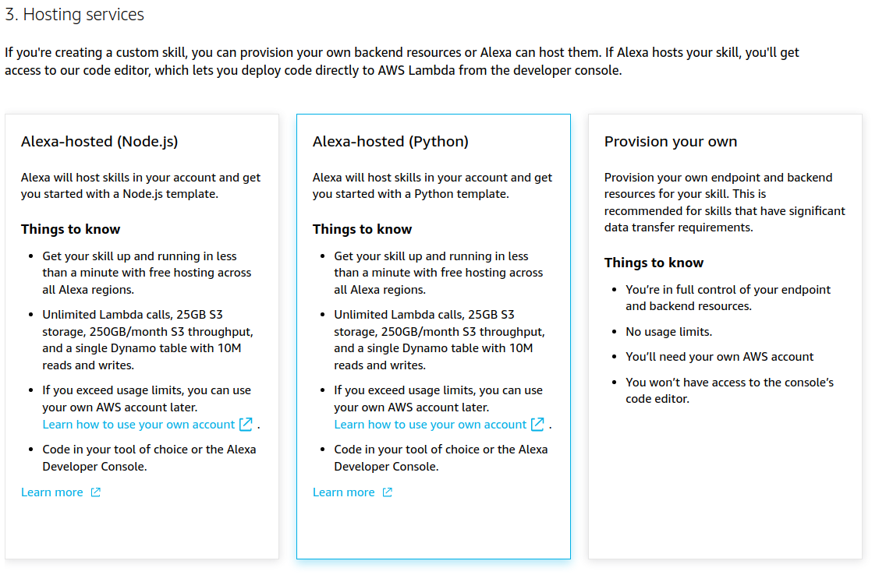
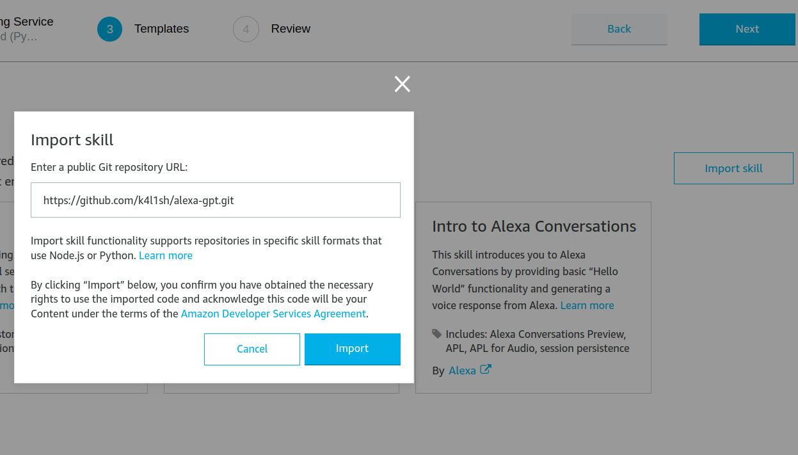

# Alexa Claude

Talk to Claude through your Amazon Echo. Say **"Alexa, open chat"** and ask anything. Claude remembers the conversation until you say "stop."

Based on [k4l1sh/alexa-gpt](https://github.com/k4l1sh/alexa-gpt), rewritten to use Anthropic's Claude instead of OpenAI's ChatGPT.

## What you need

- A free [Amazon Developer account](https://developer.amazon.com/). Sign in with the same Amazon account your Echo uses, so the skill shows up on your devices automatically.
- An **Anthropic API key** from the [Claude Console](https://console.anthropic.com/settings/keys).

**Note:** the skill uses the Claude API, not the Claude app. If your Claude plan includes monthly API credits, go to your plan's billing page and click **Link organization** to connect your Console account. The credits then cover this skill. Otherwise, the API is pay-as-you-go. Either way, with the default Haiku model a typical voice question costs a fraction of a cent.

## Setup

1. Go to the [Alexa Developer Console](https://developer.amazon.com/alexa/console/ask) and click **Create Skill**. Name it "Chat" and pick your language.

   

2. Choose **Other**, then **Custom**.

   
   

3. For hosting, choose **Alexa-hosted (Python)**. This hosting is free, so you don't need an AWS account.

   

4. Choose **Import skill** and paste the link to this repository (the `.git` URL of your copy on GitHub).

   

5. Once it's created, go to **Build → Invocations → Skill Invocation Name** if you want a different wake phrase than "chat." Then click **Save** and **Build skill**.

6. Open the **Code** tab, then `lambda_function.py`. Near the top, replace `YOUR_API_KEY` with your Anthropic key:

   ```python
   API_KEY = os.environ.get("ANTHROPIC_API_KEY", "sk-ant-...your key...")
   ```

   Click **Save**, then **Deploy**.

7. Open the **Test** tab and change "Off" to **Development**.

   

8. Type or say "open chat" to try it. It now works on any Echo signed in to the same Amazon account.

## Using it

- "Alexa, open chat" → then ask your question
- "Alexa, ask chat why is the sky blue" → a one-shot question
- "Start over" clears the conversation (English locales)
- "Stop" ends it

## Settings (top of `lambda/lambda_function.py`)

| Setting | Default | What it does |
|---|---|---|
| `MODEL` | `claude-haiku-5-5` | Haiku is fastest. `claude-sonnet-5-5` gives smarter answers but is slower and may hit Alexa's 8-second limit on long questions. |
| `SYSTEM_PROMPT` | short spoken answers | Change Claude's tone or length here. |
| `HISTORY_TURNS` | 10 | How much of the conversation Claude remembers. |

## Keep your key private

Alexa-hosted skills keep their code private, so pasting the key there is fine. **Don't** commit your key to a public GitHub repo. If you do, delete the key in the Claude Console right away and make a new one.

## Testing on your computer (optional)

```bash
pip install -r lambda/requirements.txt
ANTHROPIC_API_KEY=sk-ant-... python3 test_lambda.py "what's a good name for a cat?"
```

## License

MIT. See [LICENSE](LICENSE). Original work © k4l1sh.
